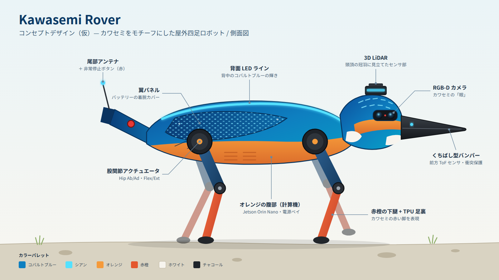
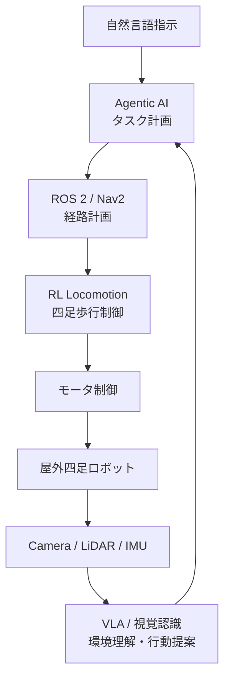

# Kawasemi Rover

**Stanford Pupper v3 を参考にした、オリジナルの屋外四足歩行ロボット開発プロジェクト**

*コンセプトデザイン（仮）。カワセミのコバルトブルーの背中、オレンジの腹部、黒く長いくちばし、赤い脚をモチーフにしています。寸法や機構は今後の設計で変わります。元データは [SVG](docs/images/kawasemi_rover_concept.svg) です。*

Kawasemi Rover（仮称）は、3D プリンタで製作する 12 自由度の四足歩行ロボットです。芝生や砂利道などの屋外不整地を歩き、巡回・探索・環境認識ができるロボットを目指しています。

[Stanford Pupper v3](https://pupper-v3-documentation.readthedocs.io/en/latest/) の機構設計と制御技術を参考にしますが、Pupper v3 のコピーではありません。筐体・機構・ソフトウェアは屋外向けに独自設計します。

> [!NOTE]
> 本プロジェクトは計画・初期設計の段階です。仕様は機構計算と実験結果に応じて変わります。

詳しい開発計画は [design.md](design.md)、分野ごとのドキュメントは [docs/](docs/) を参照してください。

---

## 目指すもの

- 屋外の地形に合わせて、脚長や胴体寸法をシミュレーションで最適化する形状設計
- Autodesk Fusion で独自設計し、3D プリンタで製作する屋外対応の四足ロボット
- ROS 2 による制御とセンサ統合
- LiDAR・RGB-D カメラによる環境認識、SLAM と Nav2 による自律移動
- 強化学習（PPO）による不整地歩行と Sim2Real
- VLA・World Model・Agentic AI による、自然言語での屋外探索と失敗からの回復

VLA は上位の行動計画を受け持ち、12 関節の歩行制御は RL ポリシーと独立した低レベル制御器が担当します。

## Pupper v3 との違い

| 項目 | Pupper v3 | Kawasemi Rover |
|---|---|---|
| 主目的 | 教育・研究用四足ロボット | 屋外探索・自律行動 |
| 機械設計 | 公開設計 | Fusion による独自の屋外対応機構 |
| 関節 | 12 自由度 | 12 自由度（1 脚 3 自由度） |
| 制御 | 歩行・姿勢制御 | 歩行・不整地適応・転倒回復 |
| センサ | 姿勢・関節センサ | 3D LiDAR、RGB-D、IMU など |
| 自律移動 | — | 屋外 SLAM・経路計画 |
| AI | RL 歩行 | RL + VLA + World Model + Agentic AI |

## 目標仕様（初期案）

| 項目 | 目標 |
|---|---|
| サイズ | 全長 35〜45 cm / 全幅 20〜25 cm / 高さ 25〜35 cm |
| 重量 | 3〜5 kg |
| 自由度 | 12（Hip Ab/Ad、Hip Flex/Ext、Knee × 4 脚） |
| フレーム・外装 | 3D プリント（PETG 等）+ 部分的な金属補強 |
| 足裏 | TPU 等の高摩擦材料 |
| 計算機 | NVIDIA Jetson Orin Nano（[決定 0001](docs/decisions/0001-main-computer-jetson-orin-nano.md)）+ STM32 / ESP32 |
| ソフトウェア | Ubuntu 22.04（JetPack 6）/ ROS 2 Humble |
| センサ | RGB-D カメラ、3D LiDAR、IMU、関節エンコーダ |
| 歩行制御 | IK + 姿勢制御 + RL |

## 開発環境

| 分野 | ツール |
|---|---|
| 機械設計 | Autodesk Fusion |
| 運動学・動力学・制御 | MATLAB / Simulink / Simscape Multibody / Robotics System Toolbox |
| シミュレーション・RL | MuJoCo / NVIDIA Isaac Lab / PyTorch |
| ロボット統合 | ROS 2 / RViz2 / Nav2 |
| VLA | LeRobot / SmolVLA |

## ロードマップ

| Phase | 内容 | 成果物 |
|---|---|---|
| 1 | 1 脚の試作（地形別の寸法評価・設計・IK・トルク推定・実機制御） | 3 自由度のオリジナル脚部 |
| 2 | 四足ロボットの製作（胴体・4 脚・IMU・ROS 2） | 12 自由度四足ロボット |
| 3 | URDF・MuJoCo モデル、PPO による歩行学習、Sim2Real | RL で歩けるロボット |
| 4 | 足裏・筐体の改良、芝生・砂利・段差・斜面の検証 | 屋外対応の四足ロボット |
| 5 | RGB-D・LiDAR 統合、SLAM、Nav2、屋外巡回 | 屋外自律巡回ロボット |
| 6 | VLA、World Model、失敗検知・回復行動 | 自然言語で探索し失敗から回復するロボット |

## 最初のタスク

- [ ] Pupper v3 の公開資料とライセンスを確認する
- [ ] 寸法をパラメータ化したモデルで、地形ごとの性能を MuJoCo で評価する
- [ ] 全体寸法・目標重量・積載量・走行時間を決める
- [ ] 1 脚 3 自由度の機構を Fusion で設計する
- [ ] MATLAB で脚の順・逆運動学を実装する
- [ ] Simscape Multibody で必要トルクを求める
- [ ] アクチュエータ候補を比較する
- [ ] 1 脚を 3D プリントして組み立て、Python から関節を制御する
- [ ] URDF/Xacro を作成し、ROS 2・MuJoCo で検証する

## 研究テーマ

**Failure-Aware Agentic Quadruped Robotics for Autonomous Outdoor Exploration**
（失敗認識型 Agentic 四足歩行ロボットによる屋外自律探索）

不整地での歩行失敗の検知、世界モデルによる失敗予測、失敗後の歩容・速度・経路の修正、未知の屋外環境への汎化を研究課題とします。

また、[RoboGrammar](https://people.csail.mit.edu/jiex/papers/robogrammar/) を参考に、対象とする屋外地形に合わせて脚長や胴体寸法を最適化する形状設計にも取り組みます。

## 参考

- [Stanford Pupper v3 Documentation](https://pupper-v3-documentation.readthedocs.io/en/latest/)
- [Stanford Pupper GitHub](https://github.com/stanfordroboticsclub/StanfordQuadruped)
- [RoboGrammar: Graph Grammar for Terrain-Optimized Robot Design](https://people.csail.mit.edu/jiex/papers/robogrammar/)（SIGGRAPH Asia 2020）

Pupper v3 の公開設計を利用・改変する際は、該当するリポジトリ・CAD・ファームウェアのライセンスを個別に確認します。

## ライセンス

本リポジトリは [MIT License](LICENSE) で公開しています。Pupper v3 など外部プロジェクト由来の設計・コードを取り込む場合は、元のライセンスに従います。
