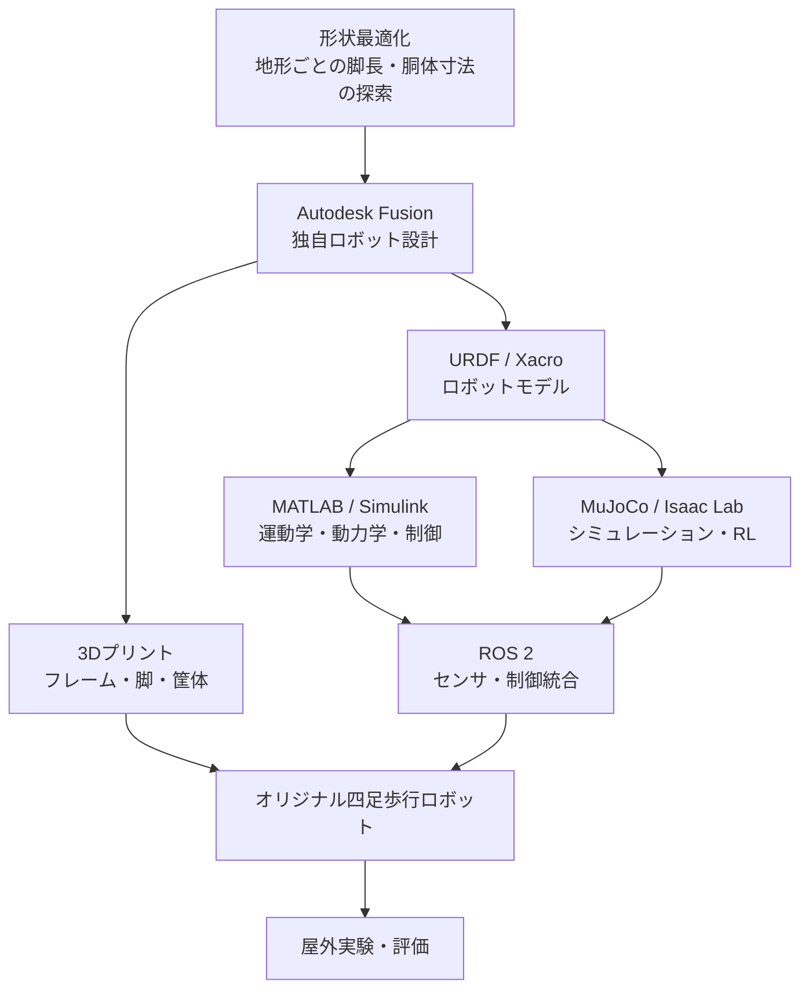
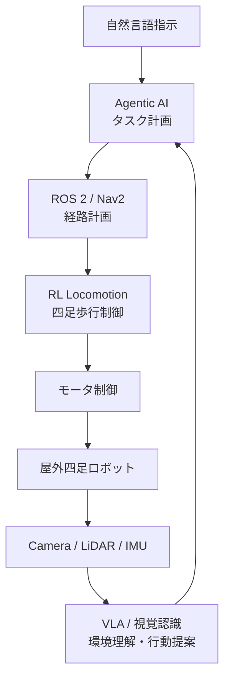

# Outdoor Quadruped Robot Project
## Pupper v3を参考にしたオリジナル屋外四足歩行ロボット開発計画

**プロジェクト名（仮）：Kawasemi Rover**

**開発方針：Stanford Pupper v3を技術的参考モデルとし、屋外環境に適したオリジナルの四足歩行ロボットを設計・製作する。**

---

# 1. プロジェクト概要

## 1.1 背景

四足歩行ロボットは、車輪型ロボットでは移動が難しい段差、草地、砂利道、不整地などでの活用が期待される。

また、ROS 2、強化学習、Vision-Language-Action（VLA）、世界モデル、Agentic AIを組み合わせることで、周辺環境の理解、移動経路の計画、失敗検知、行動の修正を行う自律ロボットへの発展が可能である。

本プロジェクトでは、Stanford Pupper v3の機構設計や制御技術を参考にしながら、独自のハードウェアとソフトウェアを開発する。

## 1.2 プロジェクトの目的

3Dプリンタを活用して、屋外環境での探索・巡回・環境認識が可能な四足歩行ロボットを自作する。

特に以下の技術を段階的に習得・実装する。

1. 3D CADによる機械設計
2. 3Dプリンタによる部品製作
3. 四足歩行ロボットの運動学・動力学
4. モータ・アクチュエータ制御
5. ROS 2によるロボット統合
6. SLAMと自律移動
7. 強化学習による不整地歩行
8. VLAによる視覚・言語に基づく行動
9. 世界モデルによる状態予測
10. Agentic Roboticsによる失敗検知・再計画

## 1.3 開発方針

### Stanford Pupper v3を参考にする部分

- 四足歩行ロボットの基本機構
- 12自由度の関節構成
- 脚部の運動学
- アクチュエータ駆動方式
- 関節制御アルゴリズム
- 強化学習による歩行
- シミュレーションから実機への移行

### オリジナル開発する部分

- 屋外環境を想定した筐体・機構
- 独自の胴体・脚部・外装デザイン
- 防塵・防滴構造
- センサ搭載機構
- 電源・バッテリー配置
- ROS 2によるシステム統合
- 屋外SLAMとナビゲーション
- VLAとAgentic AIの統合
- 世界モデルと失敗回復機能

**目標はPupper v3のコピーではなく、Pupper v3を参考にした独自の屋外ロボットプラットフォームの開発である。**

---

# 2. 参考ロボット

## 2.1 Stanford Pupper v3

Stanford Pupper v3は、教育・研究用途向けのオープンソース四足歩行ロボットである。

主な特徴：

- 12自由度の四足歩行機構
- ブラシレスモータによる関節駆動
- Raspberry Piを使用した計算環境
- 強化学習ベースの歩行制御
- CAD・ソフトウェアなどの設計情報の公開

参考資料：

- [Stanford Pupper v3 Documentation](https://pupper-v3-documentation.readthedocs.io/en/latest/)
- [Stanford Pupper GitHub](https://github.com/stanfordroboticsclub/StanfordQuadruped)

公開設計の利用・改変に際しては、実際に使用するリポジトリ、CAD、ファームウェアのライセンスを個別に確認する。

## 2.2 本プロジェクトとの差別化

| 項目 | Pupper v3を参考にする内容 | 本プロジェクト |
|---|---|---|
| 主目的 | 教育・研究用四足ロボット | 屋外探索・自律行動 |
| 機械設計 | 四足歩行機構 | 独自の屋外対応機構 |
| 製造 | 公開設計を参考 | Fusionで独自CAD設計 |
| 関節 | 12自由度 | 12自由度を基本 |
| 制御 | 歩行・姿勢制御 | 歩行・不整地適応・回復 |
| センサ | 基本姿勢・関節センサ | LiDAR、RGB-D、IMU等 |
| ROS 2 | 既存実装を参考 | 独自ノード構成 |
| 自律移動 | 開発基盤を参考 | 屋外SLAM・経路計画 |
| AI | RL歩行 | RL + VLA + World Model |
| 自己改善 | 研究拡張領域 | Agentic AIによる実験・改善 |

---

# 3. オリジナルロボットの目標仕様

| 項目 | 目標仕様 |
|---|---|
| ロボット形式 | 四足歩行ロボット犬 |
| 使用環境 | 屋外・不整地 |
| 全長 | 35〜45cm |
| 全幅 | 20〜25cm |
| 高さ | 25〜35cm |
| 重量 | 3〜5kgを設計目標 |
| 自由度 | 12自由度 |
| 脚部 | 1脚3自由度 |
| フレーム | 3Dプリント + 部分的な金属補強 |
| 外装 | PETG等 |
| 足裏 | TPU等の高摩擦材料 |
| アクチュエータ | エンコーダ付き関節駆動モータ |
| メインPC | Raspberry Pi 5 / NVIDIA Jetson |
| マイコン | STM32 / ESP32 |
| OS | Ubuntu |
| 通信 | ROS 2 |
| カメラ | RGB-D |
| LiDAR | 3D LiDAR |
| IMU | 9軸または6軸IMU |
| バッテリー | 充電式バッテリー |
| 歩行制御 | IK + 姿勢制御 + RL |
| 自律移動 | SLAM + Nav2 |
| AI | VLA + Agentic AI |
| 世界モデル | 視覚・関節状態・接地情報 |

上記は初期の設計目標であり、最終仕様ではない。

特に重量、サイズ、関節トルク、電源容量は相互に影響するため、機構計算と実験結果に基づいて決定する。

---

# 4. 屋外での利用シナリオ

## 4.1 屋外巡回

- 敷地内の巡回
- 指定地点までの自律移動
- 障害物の検出
- 周辺画像の記録
- 異常箇所の検出と報告

## 4.2 不整地移動

- 芝生
- 砂利道
- 土の地面
- 小さな段差
- 緩やかな斜面

初号機では乾燥した平坦な地面と軽微な凹凸を対象にする。

泥地、降雨中、急斜面、深い草地などでの運用は段階的に検証する。

## 4.3 Agentic Robotics

自然言語によるタスク実行の例：

> 庭の周囲を巡回して、通行できない場所があれば報告してください。

想定処理：

1. タスク指示の解釈
2. 地図・周辺環境の確認
3. 経路計画
4. 四足歩行による移動
5. 障害物・地形の認識
6. 通行可能性の判断
7. 必要に応じた再計画
8. 巡回結果の報告

---

# 5. 開発環境

## 5.1 ソフトウェア構成

| ツール | 用途 |
|---|---|
| Autodesk Fusion | 機械設計・3D CAD |
| MATLAB | 運動学・動力学 |
| Simulink | 制御アルゴリズム |
| Simscape Multibody | 多剛体シミュレーション |
| Robotics System Toolbox | ロボットモデルと運動学 |
| ROS Toolbox | MATLABとROS 2の連携 |
| MuJoCo | 四足歩行物理シミュレーション |
| NVIDIA Isaac Lab | RL学習とSim2Real |
| ROS 2 | ロボットシステム統合 |
| RViz2 | センサ・ロボット状態の可視化 |
| Nav2 | 自律移動 |
| Python | AI・制御・データ処理 |
| PyTorch | 深層学習 |
| LeRobot | VLA学習基盤 |
| SmolVLA | 視覚・言語・行動モデル |

## 5.2 機械設計から実機までの流れ

Fusionから出力するCADモデルと、ROS 2・シミュレータに使用するURDFは整合性を維持する。

URDFには関節軸、リンク形状、質量、慣性テンソル、衝突形状などを記述する。

---

# 6. 機械設計

## 6.1 基本構造

4脚それぞれに3自由度を設ける。

- Hip Abduction / Adduction：脚の左右方向
- Hip Flexion / Extension：脚の前後方向
- Knee Flexion / Extension：膝の曲げ伸ばし

合計12自由度。

## 6.2 設計対象

### 胴体

- バッテリー収納
- メインコンピュータ搭載
- モータドライバ・配線
- カメラ取付部
- LiDAR取付部
- 防塵・防滴構造
- 放熱機構

### 脚部

- 股関節構造
- 大腿リンク
- 下腿リンク
- 膝関節
- ベアリング・シャフト
- モータ固定部
- TPU製足裏

### 屋外向けの設計

- 転倒時の衝撃への対応
- 関節部の砂・埃対策
- 足裏のグリップ
- 重心の低配置
- バッテリー交換性
- メンテナンス性
- ケーブルの保護

3Dプリント部品については、積層方向、応力集中、ねじ固定部、紫外線、温度環境を考慮する。

## 6.3 地形に合わせた形状最適化

屋外では、平地、芝生、砂利、段差、斜面などで適した脚の長さや胴体の寸法が異なる。Fusionで詳細設計に入る前に、シミュレーションで形状パラメータを地形ごとに評価し、寸法を決める。

参考にする研究は RoboGrammar（Zhao et al., SIGGRAPH Asia 2020）である。RoboGrammar はグラフ文法でロボットの構成（リンクと関節のつながり）を表し、Graph Heuristic Search で地形ごとに性能の高い構成と制御器を探索する。

本プロジェクトでは、構成の探索までは行わない。12自由度・1脚3自由度の四足構成は固定し、次の寸法パラメータを最適化の対象にする。

| パラメータ | 内容 |
|---|---|
| 大腿・下腿の長さ | 歩幅、段差の乗り越え、必要トルク |
| 股関節の配置 | 胴体の前後・左右の脚間隔 |
| 胴体の寸法・重心位置 | 安定性、斜面での姿勢 |
| 足先形状 | 接地面積、滑り |
| 関節の可動範囲 | 姿勢回復、転倒復帰 |

評価の流れ：

1. 寸法をパラメータ化したモデル（URDF / MJCF）を生成する
2. MuJoCo 上で、平地・凹凸・溝・斜面・低摩擦面などの地形を用意する
3. 各候補について、歩行制御（MPC または RL）を最適化して性能を評価する
4. 移動速度、エネルギー消費、転倒率、必要関節トルクを比較する
5. アクチュエータ性能と3Dプリントの制約を満たす候補から寸法を決める

複数の地形を同時に扱うため、性能はトレードオフになる。複数の評価指標を扱う手法として、Multi-Objective Graph Heuristic Search（Xu et al., ICRA 2021）も参考にする。

---

# 7. 運動学・動力学・制御

## 7.1 MATLABによる運動学

実装する内容：

1. 3自由度脚の順運動学
2. 3自由度脚の逆運動学
3. ヤコビアン
4. 関節速度制御
5. 足先軌道生成
6. 歩容生成

脚の関節角度を

\[
q_i=
\begin{bmatrix}
q_{i1}\\
q_{i2}\\
q_{i3}
\end{bmatrix}
\]

とする。

足先位置は、

\[
p_i=f(q_i)
\]

で表す。

足先速度は、

\[
\dot p_i=J_i(q_i)\dot q_i
\]

で求める。

## 7.2 動力学

一般的な関節空間の動力学は、

\[
M(q)\ddot q+C(q,\dot q)\dot q+g(q)=\tau+J_c(q)^T f_c
\]

で表す。

- \(M(q)\)：慣性行列
- \(C(q,\dot q)\)：コリオリ・遠心力項の行列
- \(g(q)\)：重力項
- \(\tau\)：関節トルク
- \(J_c\)：接触ヤコビアン
- \(f_c\)：床反力

この式を使用し、各関節に必要なトルクを推定する。

## 7.3 Simulinkでの実装

- 関節PID制御
- 足先位置制御
- 姿勢安定化
- 歩行周期の生成
- モータモデル
- センサノイズ
- 外乱応答
- 転倒検知

## 7.4 歩行方式

初期段階では、以下の歩容を実装する。

| 歩容 | 用途 |
|---|---|
| Crawl | 低速・安定歩行 |
| Walk | 通常移動 |
| Trot | 対角脚を使った高速移動 |
| Recovery | 姿勢回復・立ち直り |

まず低速歩行を実装し、姿勢安定化と接地状態の推定を確認した後、RLによるTrotや不整地歩行へ拡張する。

---

# 8. ROS 2システム設計

## 8.1 ROS 2ノード

| ノード | 用途 |
|---|---|
| joint_state_node | 関節状態の取得 |
| motor_controller_node | モータ制御 |
| imu_node | IMUデータ取得 |
| camera_node | カメラ画像取得 |
| lidar_node | LiDAR点群取得 |
| state_estimator_node | ロボット状態推定 |
| gait_controller_node | 歩容生成 |
| locomotion_controller_node | 歩行制御 |
| slam_node | 地図作成・自己位置推定 |
| navigation_node | 経路計画 |
| vla_node | VLA推論 |
| agent_node | タスク管理・再計画 |
| safety_monitor_node | 安全監視 |

## 8.2 ROS 2トピック

| トピック | メッセージ型 | 用途 |
|---|---|---|
| `/joint_states` | sensor_msgs/JointState | 関節状態 |
| `/imu/data` | sensor_msgs/Imu | 姿勢情報 |
| `/camera/image_raw` | sensor_msgs/Image | RGB画像 |
| `/camera/depth/image_raw` | sensor_msgs/Image | 深度画像 |
| `/points` | sensor_msgs/PointCloud2 | LiDAR点群 |
| `/cmd_vel` | geometry_msgs/Twist | 移動速度目標 |
| `/joint_trajectory` | trajectory_msgs/JointTrajectory | 関節軌道 |
| `/odom` | nav_msgs/Odometry | 自己位置・速度 |
| `/map` | nav_msgs/OccupancyGrid | 地図 |
| `/task_instruction` | std_msgs/String | 言語指示 |

上記は初期設計案であり、実装するノードとメッセージ型は利用する制御システムに合わせて調整する。

高頻度の関節制御は低レベル制御器で実行し、ROS 2では状態共有と上位指令を担当する。

---

# 9. 屋外自律移動

## 9.1 センサ構成

| センサ | 目的 |
|---|---|
| RGB-Dカメラ | 物体認識、地形認識 |
| 3D LiDAR | 周辺地形・障害物の認識 |
| IMU | 姿勢・角速度推定 |
| 関節エンコーダ | 関節位置・速度 |
| モータ電流 | 負荷・接触の推定 |
| GNSS（将来） | 屋外位置推定 |
| 足裏接触センサ（将来） | 接地検知 |

## 9.2 SLAMとナビゲーション

初期実装では以下を目標とする。

- LiDAR SLAM
- Visual SLAM
- IMU・関節状態とのセンサ融合
- 地図の作成
- 障害物検出
- 経路計画
- 経路追従
- 通行可能性の評価

屋外の傾斜や段差に対応するため、2D地図だけでなく3D地形情報と地形コストマップの導入を検討する。

## 9.3 初期の屋外実験

評価項目：

- 平坦地の歩行速度
- 芝生上での歩行
- 砂利道での歩行
- 小さな段差の乗り越え
- 斜面での姿勢安定性
- 障害物回避
- 自律巡回
- バッテリー持続時間
- 関節温度
- 転倒回数

---

# 10. 強化学習

## 10.1 学習環境

主な候補：

- MuJoCo
- NVIDIA Isaac Lab
- PyTorch
- PPO

## 10.2 学習する動作

1. 立位保持
2. 低速歩行
3. Trot歩行
4. 旋回
5. 段差の乗り越え
6. 不整地歩行
7. 外乱に対する姿勢回復
8. 転倒からの復帰

## 10.3 強化学習の観測

例：

\[
o_t=
[
q_t,\dot q_t,\omega_t,g_t,v_t^{cmd},a_{t-1}
]
\]

- \(q_t\)：関節角度
- \(\dot q_t\)：関節速度
- \(\omega_t\)：機体角速度
- \(g_t\)：機体座標系での重力方向
- \(v_t^{cmd}\)：目標移動速度
- \(a_{t-1}\)：前時刻の行動

## 10.4 報酬設計

例：

\[
r_t=
w_1r_{\mathrm{velocity}}
+w_2r_{\mathrm{stability}}
-w_3c_{\mathrm{energy}}
-w_4c_{\mathrm{slip}}
-w_5c_{\mathrm{collision}}
\]

評価する内容：

- 移動速度の追従
- 姿勢の安定性
- エネルギー効率
- 足の滑り
- 衝突・転倒

## 10.5 Sim2Real

- 質量のランダム化
- 摩擦係数のランダム化
- モータ応答のランダム化
- センサノイズ
- 通信遅延
- 接触条件の変化

実機では、最初に支持具と安全停止機構を用いて検証する。

---

# 11. VLA・Agentic Robotics

## 11.1 基本方針

VLAは視覚・言語による行動指示、RLは低レベル歩行制御を担当する。

汎用VLAを直接12関節の歩行制御に使用するのではなく、上位行動計画、移動目標、行動スキル選択との統合から開始する。

## 11.2 世界モデル

視覚、関節状態、姿勢、接地情報などを用いて潜在状態を推定する。

\[
z_t=E(o_t)
\]

次の状態を予測する。

\[
\hat z_{t+1}=F(z_t,a_t)
\]

世界モデルの予測誤差やセンサ情報を利用して、滑り、障害物、姿勢の乱れなどを検出する。

## 11.3 失敗検知・回復

例：砂利道で脚が滑った場合

1. IMUと関節情報から異常を検知
2. 足の滑りを推定
3. 地形とロボット状態を記録
4. World Modelで行動結果を予測
5. 歩行速度または歩容を変更
6. 必要に応じて経路を再計画
7. 再試行の結果を評価
8. 安全性を確認してから学習データに追加

Agentic AIが分析・再計画を担当し、関節の高速制御は独立した安全なコントローラに任せる。

---

# 12. 安全性・屋外運用

## 12.1 機械的安全性

- 関節可動範囲の制限
- 最大トルク・速度の制限
- 転倒時の保護構造
- ケーブルの挟み込み防止
- 脚部の破損検知
- モータ温度監視

## 12.2 電気的安全性

- 適切なBMS
- ヒューズ
- 電源監視
- 過電流保護
- バッテリー温度監視
- 非常停止回路

## 12.3 ソフトウェア安全性

- Watchdog
- 通信途絶検知
- 姿勢異常の検知
- 転倒判定
- 制御指令の制限
- 安全停止
- ログ記録

## 12.4 屋外環境への対応

- 防塵
- 防滴
- 防振
- 衝撃対策
- 放熱
- 紫外線・温度対策
- 防水コネクタ
- メンテナンス可能な構造

初期段階では雨天運用を対象外とし、防水・防塵性能は実測に基づいて評価する。

---

# 13. 開発ロードマップ

## Phase 1：1脚の試作

### 作業

- シミュレーションで脚長・股関節配置を地形ごとに評価し、寸法を決める
- Fusionで3自由度脚を設計
- アクチュエータを選定
- 3Dプリント
- MATLABでIKを計算
- Simscapeで関節トルクを推定
- Pythonから実機制御

### 成果物

**3自由度のオリジナル脚部**

## Phase 2：四足歩行ロボット製作

### 作業

- オリジナル胴体の設計
- 4脚の組み立て
- バッテリー配置
- モータ制御
- IMU統合
- ROS 2連携
- 低速歩行

### 成果物

**自作12自由度四足歩行ロボット**

## Phase 3：動力学・RL歩行

### 作業

- URDFモデルの作成
- MuJoCoモデルの構築
- Simscapeで制御検証
- PPOによる歩行学習
- Sim2Real
- 姿勢制御の改善

### 成果物

**RLによる歩行が可能なロボット**

## Phase 4：屋外走破性の向上

### 作業

- 足裏・筐体の改良
- 関節負荷の評価
- 芝生・砂利道での歩行
- 段差・斜面の検証
- 防塵・防滴対策
- バッテリー最適化

### 成果物

**屋外環境に対応した四足ロボット**

## Phase 5：ROS 2自律移動

### 作業

- RGB-Dカメラ統合
- LiDAR統合
- SLAM
- 自己位置推定
- Nav2
- 障害物回避
- 屋外巡回

### 成果物

**屋外自律巡回ロボット**

## Phase 6：VLA・Agentic Robotics

### 作業

- VLAの統合
- 自然言語タスク
- 環境認識
- 行動計画
- 世界モデル
- 失敗検知
- 回復行動
- 実験ログと再学習

### 成果物

**自然言語による自律探索・失敗回復が可能なロボット**

---

# 14. 初期予算

| 項目 | 概算 |
|---|---:|
| 3Dプリント試作・材料 | 1万〜3万円 |
| 関節アクチュエータ12個 | 10万〜25万円以上 |
| フレーム補強・機械部品 | 2万〜5万円 |
| Raspberry Pi / Jetson | 1万〜10万円 |
| モータ制御・電源基板 | 1万〜4万円 |
| バッテリー・安全回路 | 2万〜5万円 |
| センサ搭載・配線部品 | 1万〜5万円 |
| 予備部品・再試作 | 2万〜5万円 |

概算の合計は20万〜60万円程度を想定する。

高性能な関節アクチュエータやセンサを新規調達する場合は、これを超える可能性がある。

3Dプリンタ本体、既存のLiDAR・RGB-Dカメラ、GPU PC、ソフトウェアライセンス費用は含まない。

**初期段階ではアクチュエータ3個を購入して1脚を試作し、性能を検証してから12個に拡張する。**

---

# 15. 研究への展開

## 研究テーマ案

**Failure-Aware Agentic Quadruped Robotics for Autonomous Outdoor Exploration**

日本語：

**失敗認識型Agentic四足歩行ロボットによる屋外自律探索**

### 研究課題

1. 不整地での歩行失敗をどのように検知するか
2. 視覚・姿勢・関節状態から地形をどのように理解するか
3. 世界モデルで歩行失敗を予測できるか
4. 失敗後に歩容・速度・経路を修正できるか
5. Agentic AIが失敗分析と実験を自動化できるか
6. 学習した回復能力が未知の屋外環境に一般化するか
7. 対象とする屋外地形に対して、脚長・胴体寸法などの形状をどのように最適化するか

### 評価指標

- 移動成功率
- 転倒率
- 足の滑り率
- 経路追従誤差
- エネルギー消費
- タスク達成率
- 失敗検知精度
- 回復成功率
- 未知地形での汎化性能
- 形状最適化前後の地形別性能差

---

# 16. 最初に着手する作業

## 開発タスク

- [ ] Pupper v3の公開資料とライセンスを確認する
- [ ] RoboGrammar の論文とコードを調査する
- [ ] 寸法をパラメータ化した四足モデルを作り、MuJoCo で地形ごとに評価する
- [ ] 四足歩行ロボットの全体寸法を決める
- [ ] 目標重量・積載量・走行時間を決める
- [ ] 1脚3自由度の機構をFusionで設計する
- [ ] MATLABで脚部の順・逆運動学を実装する
- [ ] Simscape Multibodyで必要トルクを求める
- [ ] アクチュエータ候補を比較する
- [ ] 3Dプリンタと材料を準備する
- [ ] 1脚を3Dプリントして組み立てる
- [ ] Pythonから関節を制御する
- [ ] URDF/Xacroを作成する
- [ ] ROS 2で関節状態と制御指令を接続する
- [ ] MuJoCoで1脚・四足モデルを検証する
- [ ] 実機とシミュレーションの差を測定する

---

# 17. 最終目標

**Stanford Pupper v3を参考としながら、Autodesk Fusionで独自設計した屋外四足歩行ロボットを3Dプリンタで製作する。**

ROS 2による制御、LiDAR・カメラによる環境認識、SLAMと自律移動、強化学習による不整地歩行を実現する。

さらに、VLA、World Model、Agentic AIを統合し、自然言語による屋外探索、失敗の認識、行動の再計画、継続的な性能改善が可能な研究用ロボットプラットフォームへ発展させる。
